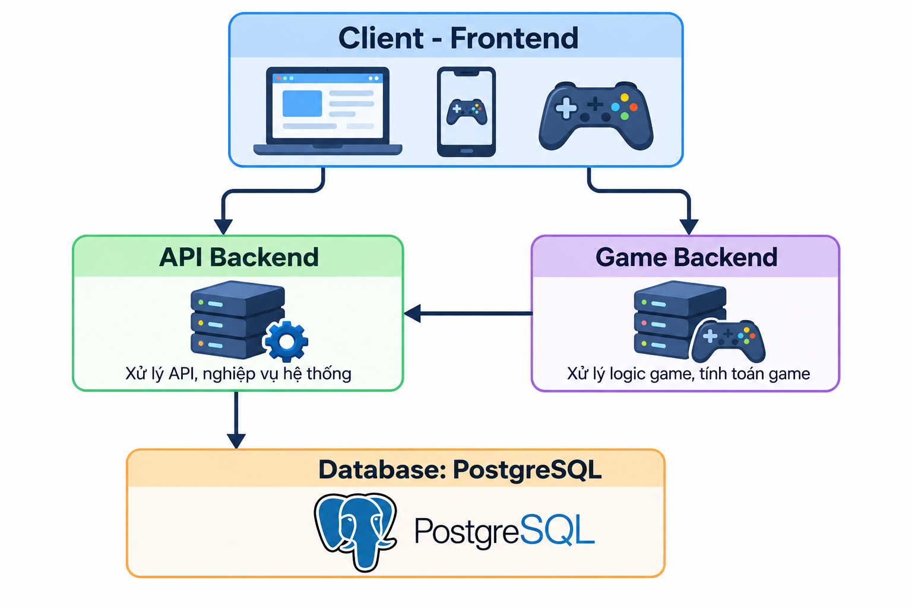

# Triển khai ứng dụng web trên môi trường Kubernetes

## 1. Kiến trúc dự án

Dự án [`zodiac`](https://github.com/QuocGia12/NT208-Project.git) là một web game gồm 4 thành phần:

- **Client-Frontend**
- **API Backend**: xử lý API và nghiệp vụ hệ thống
- **Game Backend**: xử lý logic game trong trận đấu
- **Database**: PostgreSQL



Trong mô hình triển khai này, database được đặt trên một server độc lập. Ba thành phần còn lại (Frontend, API Backend, Game Backend) được triển khai trên Kubernetes.

## 2. Yêu cầu tiên quyết (Prerequisites)

- Kubernetes cluster đã được cài đặt Ingress Controller.

## 3. Image sử dụng biến môi trường runtime

Để các biến môi trường được định nghĩa trong ConfigMap hoặc Secret có thể áp dụng cho ứng dụng, dự án cần được viết theo hướng đọc biến môi trường tại thời điểm runtime, thay vì cố định (hard-code) giá trị trong image.

Dự án `zodiac` đã được chuẩn bị sẵn để đáp ứng yêu cầu này.

Dự án gồm 4 image:

- `zodiac-frontend`
- `zodiac-api-backend`
- `zodiac-game-backend`
- `zodiac-db`: dùng để thiết lập database (migration và seed)

```bash
docker build -t zodiac-frontend client
docker build --target runner -t zodiac-api-backend server/api
docker build --target db -t zodiac-db server/api
docker build -t zodiac-game-backend server/game
```

Sau khi build, các image cần được push lên registry để các Pod trên Kubernetes có thể pull về.

## 4. Triển khai trên Kubernetes

### 4.1. Ý tưởng thiết kế

- Ba thành phần Frontend, API Backend và Game Backend đều cần được expose ra internet để client truy cập. Do đó, mỗi thành phần sử dụng một Ingress để định tuyến traffic đến ClusterIP Service tương ứng.
- Việc thiết lập database chỉ cần thực hiện một lần, vì vậy sử dụng Kubernetes Job để chạy container từ image `zodiac-db`.
- Frontend, API Backend và Game Backend đều sử dụng biến môi trường, ta sử dụng ConfigMap và Secret để lưu trữ các biến này, cách làm này cho phép thay đổi giá trị biến môi trường nhanh chóng mà không cần build lại image.

### 4.2. Các file cấu hình

Các file YAML cấu hình tài nguyên Kubernetes được đặt trong thư mục `k8s/`:

| File | Mô tả |
|---|---|
| `config-map.yaml` | ConfigMap cho Frontend, API Backend và Game Backend |
| `secret.yaml` | Secret cho API Backend và Game Backend |
| `setup-db-job.yaml` | Job thiết lập database |
| `fe.yaml` | Deployment, ClusterIP Service và Ingress cho Frontend |
| `api-be.yaml` | Deployment, ClusterIP Service và Ingress cho API Backend |
| `game-be.yaml` | Deployment, ClusterIP Service và Ingress cho Game Backend |

### 4.3. Cấu hình mặc định

Các file Kubernetes trên đang sử dụng các cấu hình sau (có thể thay đổi theo nhu cầu):

- Namespace: `zodiac-game`
- Image: được build sẵn trên Docker Hub với namespace `qgiaaa`
- Host của Frontend, API Backend và Game Backend lần lượt là `zodiac.lab`, `zodiac-api-be.lab` và `zodiac-game-be.lab`

### 4.4. Thứ tự áp dụng (apply)

1. Namespace
2. `config-map.yaml` và `secret.yaml`
3. `setup-db-job.yaml`
4. `api-be.yaml`
5. `game-be.yaml`
6. `fe.yaml`